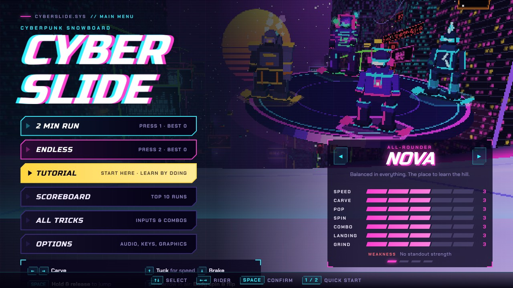
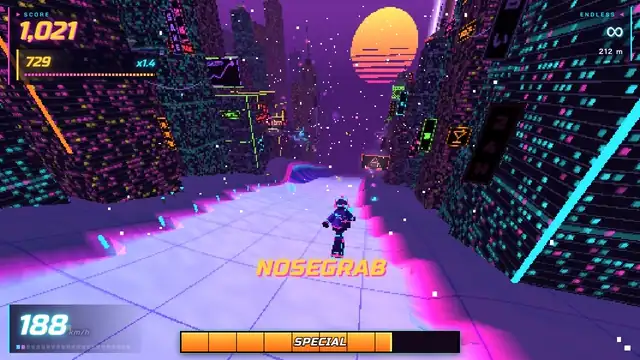
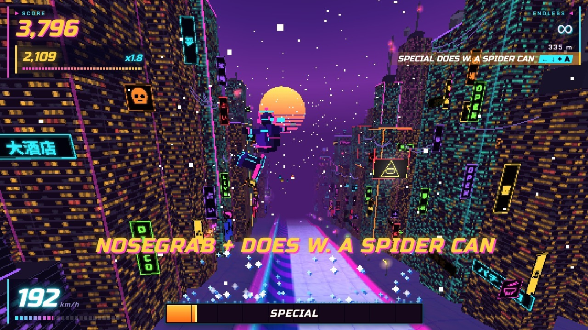
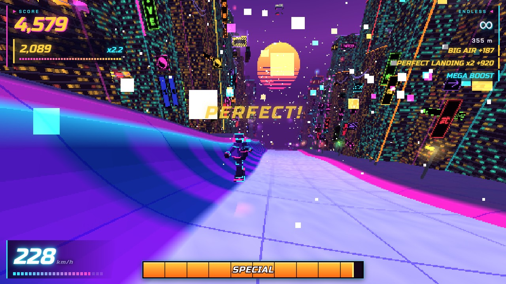
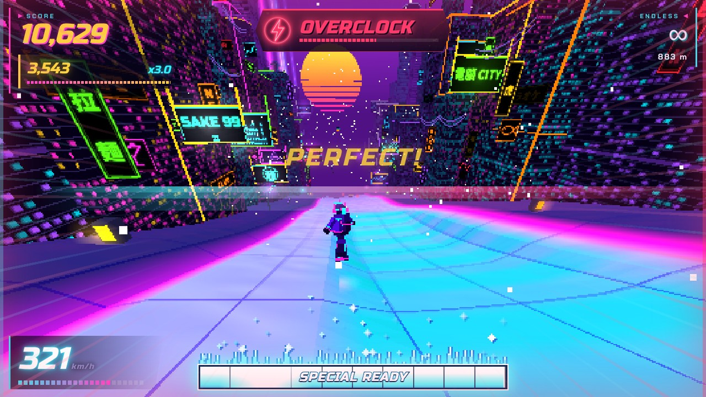
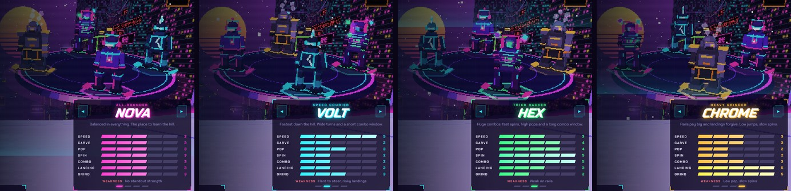
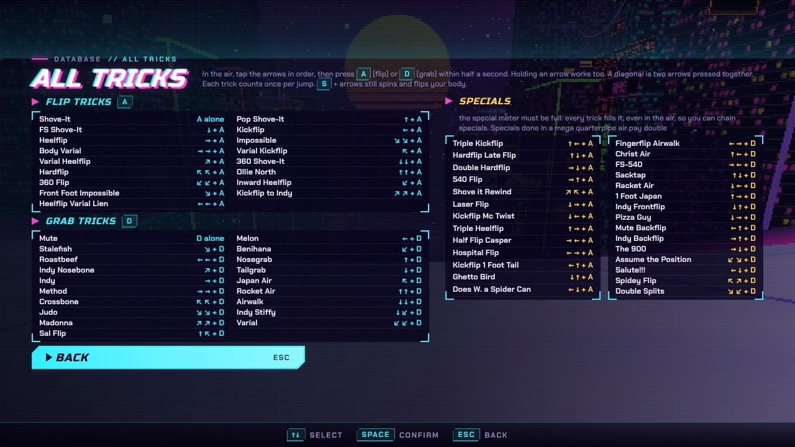
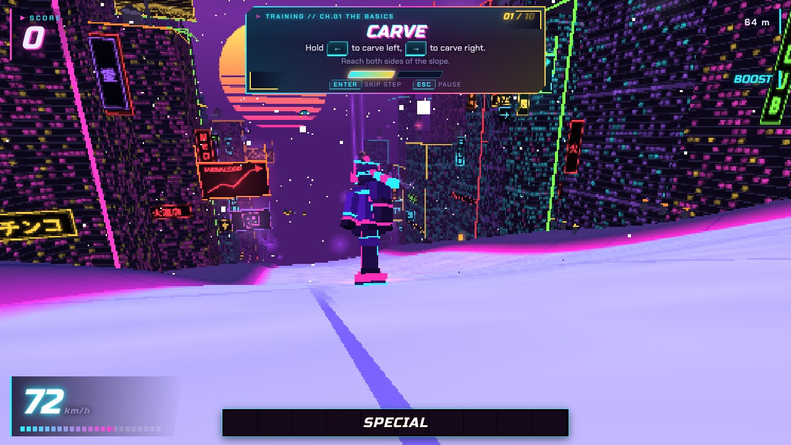
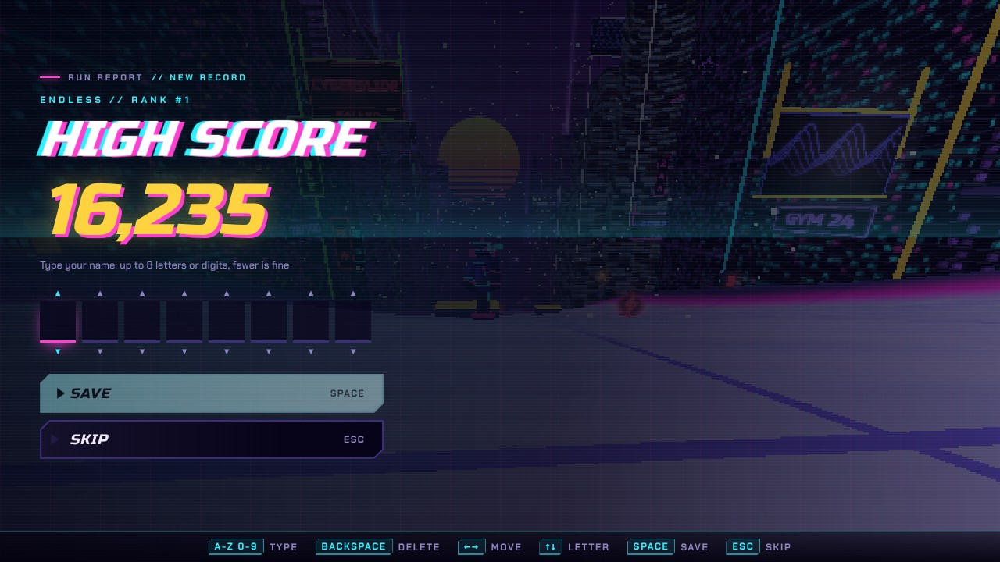
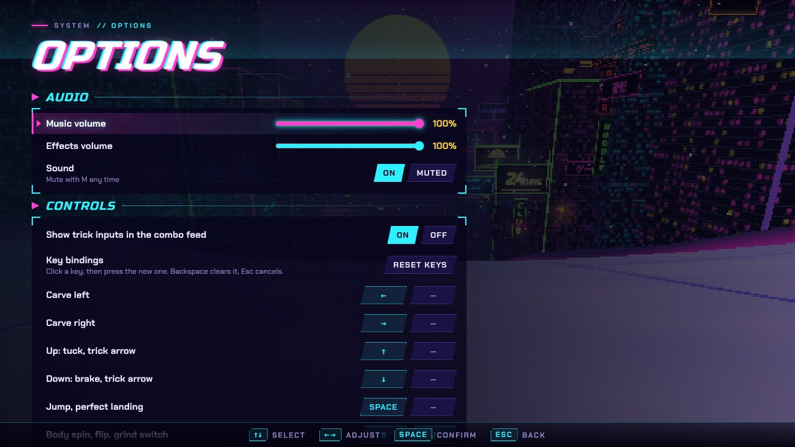

<div align="center">



# CYBERSLIDE

**A neon 3D arcade snowboard game for the browser.**<br>
Drop down an endless hill through a cyberpunk city, chain tricks and grinds, nail the perfect landing.

[](https://realz4nix.github.io/Cyberslide/)

[](https://github.com/RealZ4NIX/Cyberslide/actions/workflows/deploy.yml)




</div>

---

## The run

Retro PS2 looks, neon towers on both sides, a generated drum & bass soundtrack and a hill that never ends. Carve the
bends, launch off kickers and quarterpipes, flip and grab in the air, then tap **Space** right before touchdown for a
**perfect landing**. Easy to learn, hard to master.


<p align="center"><sub><b>NOSEGRAB + DOES W. A SPIDER CAN</b> Off the lip of a side quarterpipe: <kbd>←</kbd> <kbd>↓</kbd> + <kbd>A</kbd> with a full special meter</sub></p>

<table>
  <tr>
    <td width="50%"></td>
    <td width="50%"></td>
  </tr>
  <tr>
    <td align="center"><sub><b>PERFECT!</b> Back down from a quarterpipe, combo still alive</sub></td>
    <td align="center"><sub><b>OVERCLOCK</b> Speed boost with a glitch effect</sub></td>
  </tr>
</table>

## Features

- **Two modes:** a 2-minute score attack and an endless run
- **64 tricks:** flip tricks, grab tricks and specials, each a short arrow sequence plus one button
- **Combos that pay:** a spin or flip mixed with tricks in one jump scores as one big trick
- **Perfect landings:** time your tap to land clean, get a speed boost and build a perfect streak
- **Rails and quarterpipes:** grind ground rails, launch out of the side pipes, reach for the sky pickups
- **Power-ups** on the track and in the sky
- **Four riders** with their own stats and weaknesses (and maybe one more, if you know the code)
- **Learn-by-doing tutorial** from your first carve to your first special
- **Local scoreboard** with the top 10 runs per mode
- **Full controller support:** analog steering, rumble, menu navigation, remapping and auto-switching button prompts
- **Options** for audio, key bindings, field of view, resolution, a CRT filter and more

## Riders



| Rider      | Role          | Plays like                                             | Weakness                      |
| ---------- | ------------- | ------------------------------------------------------ | ----------------------------- |
| **NOVA**   | All-rounder   | Balanced in everything. The place to learn the hill.   | No standout strength          |
| **VOLT**   | Speed courier | Fastest down the hill. Wide turns, short combo window. | Hard to steer, risky landings |
| **HEX**    | Trick hacker  | Fast spins, high pops and a long combo window.         | Weak on rails                 |
| **CHROME** | Heavy grinder | Rails pay big and landings forgive.                    | Low pop, slow spins           |

## Controls

| Action                 | Keyboard                                   | Controller                  |
| ---------------------- | ------------------------------------------ | --------------------------- |
| Carve                  | <kbd>←</kbd> <kbd>→</kbd>                  | Left stick / D-pad          |
| Tuck for speed / brake | <kbd>↑</kbd> / <kbd>↓</kbd>                | Left stick / D-pad          |
| Jump (hold & release)  | <kbd>Space</kbd>                           | Cross / A                   |
| Perfect landing        | Tap <kbd>Space</kbd> just before touchdown | Cross / A                   |
| Flip trick             | Arrows, then <kbd>A</kbd> or <kbd>L</kbd>  | Direction, then Square / X  |
| Grab trick             | Arrows, then <kbd>D</kbd> or <kbd>K</kbd>  | Direction, then Circle / B  |
| Body spin & flip       | <kbd>S</kbd> or <kbd>J</kbd> + arrow       | L2 / R2 + direction         |
| Pause · Restart · Mute | <kbd>P</kbd> · <kbd>R</kbd> · <kbd>M</kbd> | Options · Create · Touchpad |

Stop tricking for 2 seconds to bank your combo; land wrong and it's gone. Every trick fills the special meter, and
once it's full you can throw specials. Specials in a mega quarterpipe air pay double. All keys and buttons can be
rebound in the options.

<table>
  <tr>
    <td width="50%"></td>
    <td width="50%"></td>
  </tr>
  <tr>
    <td align="center"><sub><b>ALL TRICKS</b> Every input on one screen</sub></td>
    <td align="center"><sub><b>TUTORIAL</b> Learn by doing, step by step</sub></td>
  </tr>
</table>

## Power-ups

Spinning holograms on the track and in the sky. Track ones are common; sky ones float above kickers, big ramps and
quarterpipes and are stronger. Grabbing one that is already running refreshes its timer.

| Power-up         | Icon               | Effect                                            |
| ---------------- | ------------------ | ------------------------------------------------- |
| **Overclock**    | 🟥 red bolt        | Short, hard speed boost with a glitch effect      |
| **Score x2**     | 🟨 gold chip       | Double points for a few seconds                   |
| **Combo shield** | 🟦 cyan shield     | Your next bail within 20 s doesn't wipe the combo |
| **Low-grav**     | 🟪 purple planet   | Floatier, higher jumps                            |
| **Time chip**    | 🟩 green stopwatch | Adds seconds to the clock (2-minute mode only)    |

<table>
  <tr>
    <td width="50%"></td>
    <td width="50%"></td>
  </tr>
  <tr>
    <td align="center"><sub><b>HIGH SCORE</b> Put your name on the board</sub></td>
    <td align="center"><sub><b>OPTIONS</b> Audio, key bindings, graphics</sub></td>
  </tr>
</table>

## Develop

Built with Vite, TypeScript and three.js. The soundtrack and sound effects are generated live with WebAudio.

```sh
npm install
npm run dev          # local server with hot reload
npm test             # unit tests (Vitest)
npm run typecheck    # tsc, strict
npm run format       # Prettier
npm run build        # production build into dist/
```

Every push to `main` runs typecheck, tests, format check and build, then deploys `dist/` to GitHub Pages
(`.github/workflows/deploy.yml`). Pull requests run the same checks without deploying.

See [docs/structure.md](docs/structure.md) for what each module does and how they fit together.

<div align="center">
<br>
<sub>Made with neon, snow and drum & bass.</sub>
</div>
